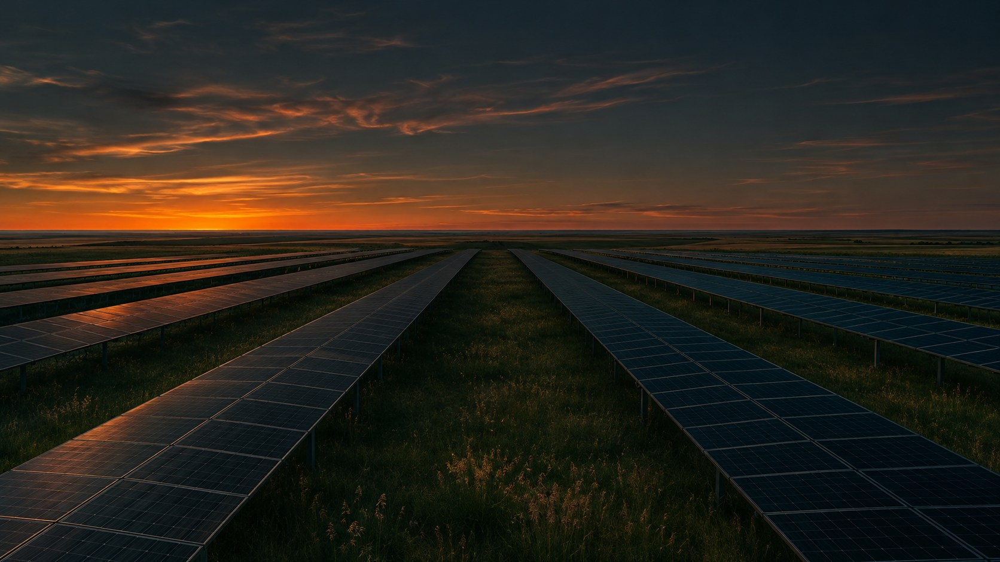
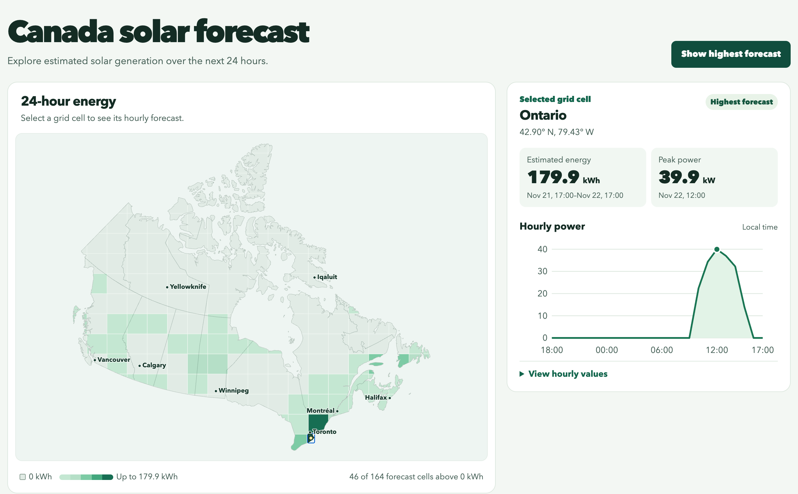
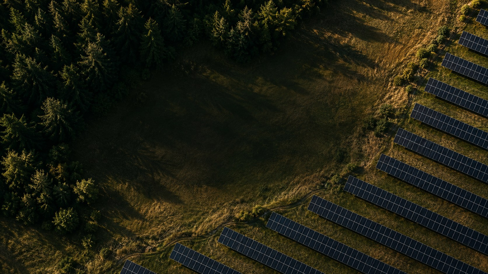

## {#cover .cover}

```{=html}
<div class="cover-copy">
  <p class="course">CSC2701 <span>Project update</span></p>
  <h1>SolarPower<br><span>Rangers</span></h1>
  <p class="subtitle">Estimated solar output, hour by hour across Canada.</p>
</div>

```

::: {.notes}
The dashboard estimates output for the model’s reference system. The cover image is an illustrative installation generated with OpenAI ImageGen.
:::

## A forecast you can compare {#why}

```{=html}
<p class="lede">Where and when is solar output expected to peak?</p>
<div class="scope" role="group" aria-label="Dashboard forecast coverage">
  <div><strong>164</strong><h3>Canadian grid cells</h3><p>One sampled land point per cell.</p></div>
  <div><strong>24</strong><h3>Hours in one window</h3><p>Every location shares the same forecast period.</p></div>
</div>
<p class="scope-note">The map compares total energy in kWh. Each cell shows hourly power in kW and its peak in local time.</p>
```

::: {.notes}
The comparison covers 24 complete hours. The grid uses 300 km cells with a smaller dedicated cell for Prince Edward Island.

Sources: [dashboard README](https://github.com/UofT-CSC2701-2026/SolarPowerRangers#canada-solar-forecast-ui) and [Canada grid](https://github.com/UofT-CSC2701-2026/SolarPowerRangers/blob/main/web/canada-grid.json).
:::

## Explore the dashboard {#demo .dark}

```{=html}
<div class="demo-layout">
  <figure>
    
    <figcaption>Forecast snapshot from November 21, 2026</figcaption>
  </figure>
  <div class="demo-copy">
    <p><strong>Select a grid cell</strong><br>Read its total energy, hourly curve and local peak.</p>
    <p><strong>Show highest forecast</strong><br>Jump to the cell with the highest 24-hour energy estimate.</p>
    <a class="action" href="https://solarpowerrangers-ui-wme4w5h72a-ew.a.run.app/" target="_blank" rel="noopener">Open the dashboard <span aria-hidden="true">↗</span></a>
  </div>
</div>
```

::: {.notes}
Choose any grid cell, then use Show highest forecast. Explain the difference between the energy estimate and the hourly curve.

The screenshot uses a November 21 forecast from the [deployed forecast API](https://solarpowerrangers-ui-wme4w5h72a-ew.a.run.app/forecast/canada). The live app serves a rolling window.
:::

## One day in an Ontario grid cell {#example}

```{=html}
<div class="example-layout">
  <figure class="forecast-figure">
    <svg class="forecast-chart" viewBox="0 0 850 360" role="img" aria-labelledby="curve-title curve-detail">
    <title id="curve-title">Forecast hourly power for one Ontario grid cell</title>
    <desc id="curve-detail">The forecast peaks at 39.9 kilowatts at noon on November 22. Most overnight hours are zero.</desc>
    <text class="axis-caption" x="8" y="26">POWER (kW)</text>
    <line class="axis-line" x1="65" y1="290" x2="837" y2="290"/>
    <text x="50" y="296" text-anchor="end">0</text>
    <line class="axis-line" x1="65" y1="234" x2="837" y2="234"/>
    <text x="50" y="240" text-anchor="end">10</text>
    <line class="axis-line" x1="65" y1="178" x2="837" y2="178"/>
    <text x="50" y="184" text-anchor="end">20</text>
    <line class="axis-line" x1="65" y1="122" x2="837" y2="122"/>
    <text x="50" y="128" text-anchor="end">30</text>
    <line class="axis-line" x1="65" y1="66" x2="837" y2="66"/>
    <text x="50" y="72" text-anchor="end">40</text>
    <text x="81.5" y="324" text-anchor="middle">18:00</text>
    <text x="273.5" y="324" text-anchor="middle">00:00</text>
    <text x="465.5" y="324" text-anchor="middle">06:00</text>
    <rect class="power-bar" x="581" y="164.47" width="25" height="125.53"><title>Nov 22, 10:00: 22.416 kW</title></rect>
    <rect class="power-bar" x="613" y="97.94" width="25" height="192.06"><title>Nov 22, 11:00: 34.297 kW</title></rect>
    <rect class="peak-bar" x="645" y="66.29" width="25" height="223.71"><title>Nov 22, 12:00: 39.949 kW</title></rect>
    <text x="657.5" y="324" text-anchor="middle">12:00</text>
    <rect class="power-bar" x="677" y="82.99" width="25" height="207.01"><title>Nov 22, 13:00: 36.966 kW</title></rect>
    <rect class="power-bar" x="709" y="109.54" width="25" height="180.46"><title>Nov 22, 14:00: 32.225 kW</title></rect>
    <rect class="power-bar" x="741" y="211.62" width="25" height="78.38"><title>Nov 22, 15:00: 13.997 kW</title></rect>
    <text x="817.5" y="324" text-anchor="middle">17:00</text>
  </svg>
    <figcaption>Forecast issued November 21, 2026. Hours are shown in Eastern time.</figcaption>
  </figure>
  <div class="metrics">
    <div><strong>179.9 <span>kWh</span></strong><p>Estimated energy over 24 hours</p></div>
    <div><strong>39.9 <span>kW</span></strong><p>Peak power at noon on November 22</p></div>
  </div>
</div>
```

::: {.notes}
This is the dashboard’s highest-ranked cell in the same snapshot shown on the demo slide. It is centered at 42.90° N, 79.43° W. The chart uses the 24 hourly estimates returned for cell 24-2 by the [forecast API](https://solarpowerrangers-ui-wme4w5h72a-ew.a.run.app/forecast/canada), with the window ending at 17:00 Eastern on November 22. These are model estimates for the reference system.
:::

## Forecast architecture {#architecture}

```{=html}
<div class="architecture-flow" role="group" aria-label="Forecast data flows from Open-Meteo through the FastAPI service to the dashboard">
  <article class="architecture-edge">
    <p class="label">Weather data</p>
    <h3>Open-Meteo</h3>
    <p>Hourly irradiance, temperature and cloud cover</p>
  </article>
  <span class="architecture-arrow" aria-hidden="true"></span>
  <article class="architecture-service">
    <p class="label">Cloud Run container</p>
    <h3>FastAPI forecast service</h3>
    <ol>
      <li>Align weather to the 164-cell Canada grid.</li>
      <li>Estimate hourly power with the bundled XGBoost model.</li>
      <li>Sum the hourly estimates to get 24-hour energy.</li>
    </ol>
  </article>
  <span class="architecture-arrow" aria-hidden="true"></span>
  <article class="architecture-edge">
    <p class="label">Browser</p>
    <h3>Canada dashboard</h3>
    <p>Energy map and hourly power chart</p>
  </article>
</div>
<p class="architecture-note">The browser reads the forecast from <code>GET /forecast/canada</code>.</p>
```

::: {.notes}
FastAPI aligns cells to a common UTC window and computes local calendar features before calling XGBoost. The browser requests `/forecast/canada`. A separate daily prediction API uses a model in Cloud Storage.

Sources: [hourly forecast service](https://github.com/UofT-CSC2701-2026/SolarPowerRangers/blob/main/hourly_forecast.py) and [FastAPI routes](https://github.com/UofT-CSC2701-2026/SolarPowerRangers/blob/main/main.py).
:::

## How changes reach Cloud Run {#release .dark}

```{=html}
<p class="lede">GitHub Actions builds the UI, API and hourly model into one Docker image.</p>
<ol class="release-steps">
  <li><h3>Build &amp; test</h3><p>Check the frontend and run a container smoke test.</p></li>
  <li><h3>Publish</h3><p>Push the tested image to Artifact Registry.</p></li>
  <li><h3>Verify</h3><p>Check the candidate revision against live weather.</p></li>
  <li><h3>Route traffic</h3><p>Send public traffic to the verified revision.</p></li>
</ol>
<p class="branch-note">Branch pushes and pull requests run the build and test. A push to <code>main</code> runs the full release.</p>
```

::: {.notes}
On main, GitHub Actions uses Workload Identity Federation to sign in to Google Cloud with short-lived credentials. It publishes the tested image by commit SHA and deploys it by digest.

Sources: [workflow](https://github.com/UofT-CSC2701-2026/SolarPowerRangers/blob/main/.github/workflows/ci-cd.yml) and [deployment script](https://github.com/UofT-CSC2701-2026/SolarPowerRangers/blob/main/scripts/deploy_cloud_run.sh).
:::

## Two tests, different weather inputs {#testing}

```{=html}
<div class="test-comparison">
  <article>
    <p class="label">In GitHub Actions</p>
    <h3>Fixed weather</h3>
    <p>Run the container without network access and check model startup and forecast output for all 164 cells.</p>
  </article>
  <article>
    <p class="label">On the Cloud Run candidate</p>
    <h3>Live weather</h3>
    <p>Check that the candidate can fetch weather and return a fresh forecast with 24 hourly values and consistent energy totals.</p>
  </article>
</div>
<p class="test-note">Both checks verify that the dashboard and model serve valid responses.</p>
```

::: {.notes}
The fixture test requires full coverage. The live test permits partial weather coverage and checks the time window, energy sum and highest-cell ranking for the available forecasts.

Sources: [container check](https://github.com/UofT-CSC2701-2026/SolarPowerRangers/blob/main/.github/actions/check-container/action.yml) and [forecast smoke test](https://github.com/UofT-CSC2701-2026/SolarPowerRangers/blob/main/scripts/smoke_forecast.py).
:::

## Verify first, then switch traffic {#traffic .warm}

```{=html}
<div class="traffic-flow">
  <article>
    <p class="label">While testing</p>
    <div class="traffic-row"><span>Current revision</span><strong>100%</strong></div>
    <div class="traffic-row"><span>Candidate revision</span><strong>0%</strong></div>
  </article>
  <span class="flow-arrow" aria-hidden="true">→</span>
  <article>
    <p class="label">After the live check passes</p>
    <div class="traffic-row"><span>Previous revision</span><strong>0%</strong></div>
    <div class="traffic-row"><span>Verified revision</span><strong>100%</strong></div>
  </article>
</div>
<p class="deploy-result"><a href="https://github.com/UofT-CSC2701-2026/SolarPowerRangers/actions/runs/44953561107">First deployment from main passed ↗</a> <span>November 21, 2026</span></p>
```

::: {.notes}
The candidate’s tagged URL is accessible to the test while it receives no regular service traffic. If the check fails, the script stops before routing traffic. The first deployment from main passed the build, live check and traffic switch.

Sources: [first deployment run](https://github.com/UofT-CSC2701-2026/SolarPowerRangers/actions/runs/44953561107) and [deployment script](https://github.com/UofT-CSC2701-2026/SolarPowerRangers/blob/main/scripts/deploy_cloud_run.sh).
:::

## Validating the forecast {#validation .validation}

```{=html}
<p class="lede">Forecast accuracy across Canada is still unvalidated.</p>
<dl class="validation-list">
  <div><dt>Forecast inputs</dt><dd>Use archived weather forecasts to measure how forecast errors affect output estimates.</dd></div>
  <div><dt>Cold-weather performance</dt><dd>Compare estimates with measured solar generation at Canadian sites, including during cold periods.</dd></div>
</dl>

```

::: {.notes}
The hourly model uses observed weather for training. The serving code flags forecasts when daylight temperatures fall outside the training range.

Sources: [model limitations](https://github.com/UofT-CSC2701-2026/SolarPowerRangers/blob/main/README.md) and [hourly forecast service](https://github.com/UofT-CSC2701-2026/SolarPowerRangers/blob/main/hourly_forecast.py). Aerial image generated with OpenAI ImageGen.
:::

## Project contributors {#team}

```{=html}
<ul class="contributors">
  <li>Nishil Kapadia</li>
  <li>Shivam Chanan</li>
  <li>Varun Patel</li>
  <li>Alex Lewis</li>
</ul>
```

::: {.notes}
Nishil Kapadia contributed the dashboard and CI/CD. Shivam Chanan contributed Google Cloud deployment. Varun Patel contributed the dataset and model. Alex Lewis is a project contributor.
:::

## Compare two regions {#try-it .dark .closing}

```{=html}
<p class="lede">Pick two locations and see how their next 24 hours differ.</p>
<a class="action" href="https://solarpowerrangers-ui-wme4w5h72a-ew.a.run.app/" target="_blank" rel="noopener">Open the live dashboard <span aria-hidden="true">↗</span></a>
<a class="qr-link" href="https://solarpowerrangers-ui-wme4w5h72a-ew.a.run.app/" target="_blank" rel="noopener">
  
  <span>Scan to open</span>
</a>
```

::: {.notes}
Invite the audience to compare two cells over the same time window. The QR code opens the [public dashboard](https://solarpowerrangers-ui-wme4w5h72a-ew.a.run.app/).
:::
